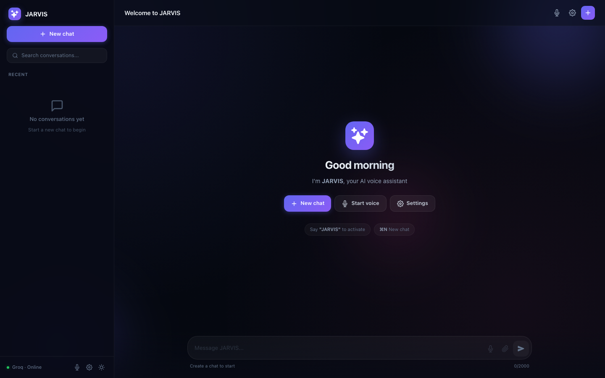

# JARVIS — AI Chat Assistant (Frontend)

A ChatGPT-style assistant with voice. Chat with a large language model, get replies streamed in real time, and talk to it hands-free with a wake word.

**Live demo:** https://ai-ui-app-chi.vercel.app/
**Backend repository:** https://github.com/SachinGaikwad2204/ai-backend



## Features

- Real-time streamed replies over Server-Sent Events
- Multiple chat sessions: create, rename, search and delete conversations
- Voice input and spoken replies using the Web Speech API, with a "JARVIS" wake word
- Markdown replies with syntax-highlighted code blocks
- Dark and light themes, and keyboard shortcuts

## Tech stack

React 19, Tailwind CSS, react-markdown, highlight.js, Web Speech API, Vercel

## How it works

The React app talks to a Spring Boot backend that keeps chat sessions in PostgreSQL and forwards prompts to an LLM on Groq. Replies are streamed back to the browser through an `EventSource` connection and rendered as Markdown.

## Run locally

```bash
git clone https://github.com/SachinGaikwad2204/ai-ui.git
cd ai-ui
npm install
npm start
```

The app opens at http://localhost:3000. The backend URL is set in `src/services/api.js`.

Voice features need Chrome or Edge.

## Author

Sachin Gaikwad — [Portfolio](https://my-portfolio-ten-orpin-42.vercel.app/) · [GitHub](https://github.com/SachinGaikwad2204)
